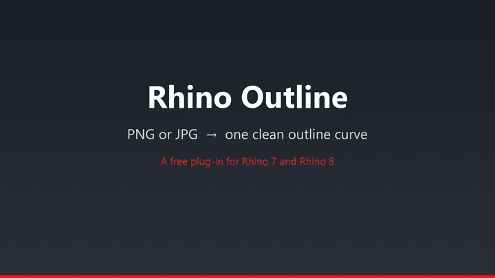
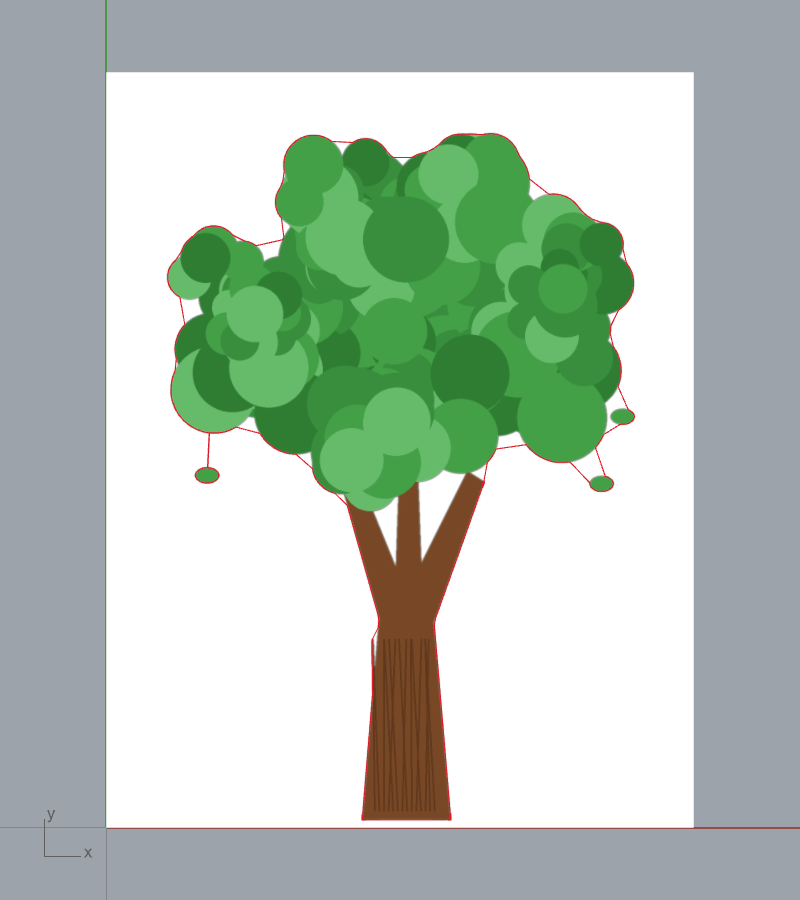
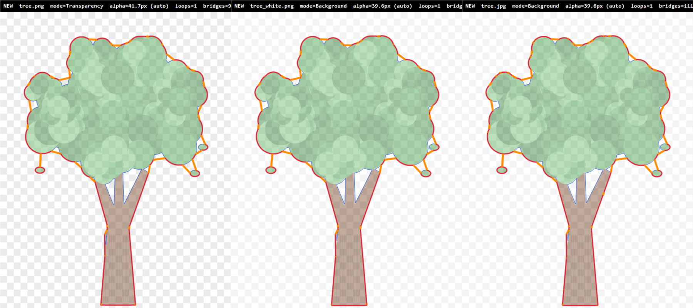
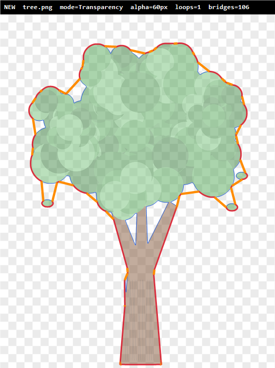
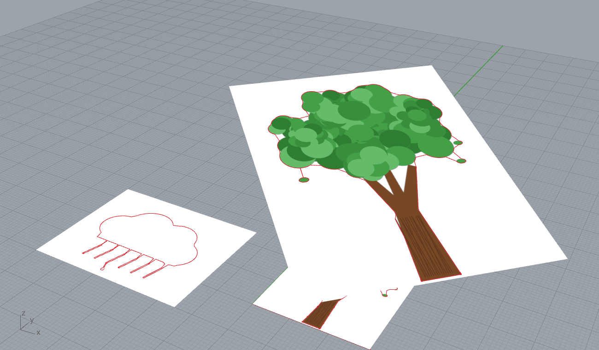
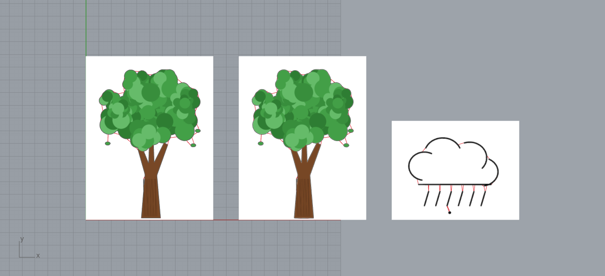
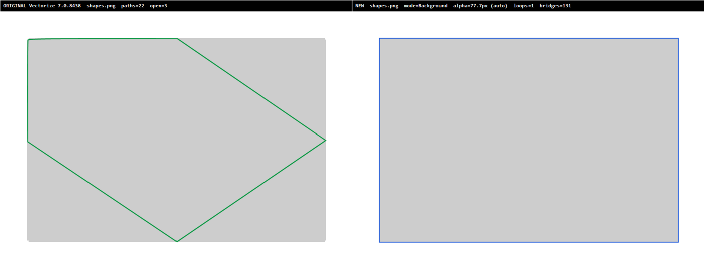
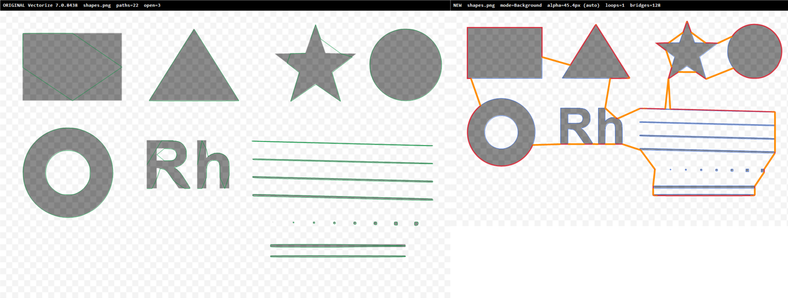
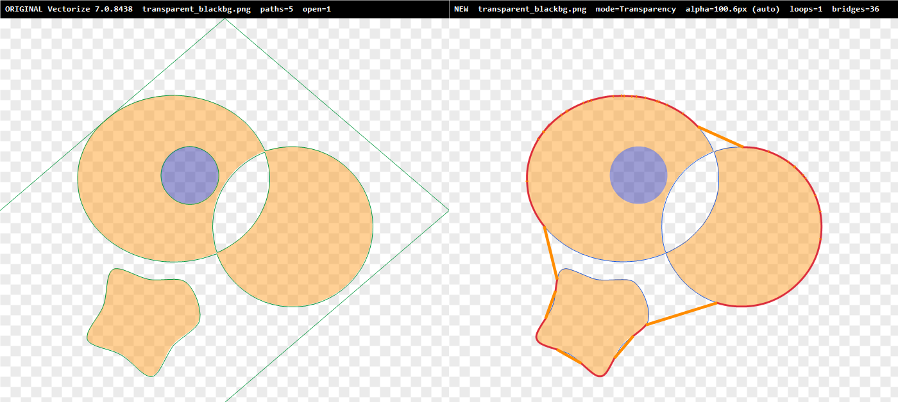
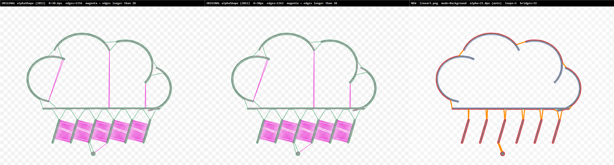

# Rhino Outline

A Rhino 7 and Rhino 8 plug-in that turns a PNG or JPG into a closed outline curve.

* **`Outline`**: pick an image file and its outline appears in the model.
* **`OutlinePicture`**: select pictures already in the model (made with Rhino's `Picture`
  command) and each gets its outline, lying on the picture whatever its position, rotation, size
  or tilt. Cropped (trimmed) pictures are outlined from the part you can see.

[](https://github.com/libishm1/rhino-outline/releases/download/v1.0.0/rhino-outline-demo.mp4)

▶ [Watch or download the 31 s demo video (MP4)](https://github.com/libishm1/rhino-outline/releases/download/v1.0.0/rhino-outline-demo.mp4)

```
Outline  ->  file explorer opens  ->  pick tree.png  ->  outline curve on the canvas
```



Under the hood the image is **vectorised** with Potrace (the "vector raster") and the
**alpha shape** of the traced curves gives the outline. Pieces that do not touch, such as loose
leaves or the strokes of a drawing, are wrapped into one outline automatically.

> **Branch `explore/segmentation` (experimental, not released).** Adds `Detect=Shadows`
> (background removal that ignores cast shadows, no download), `Detect=AI` (salient object
> networks: U²-Net small, IS-Net, BiRefNet lite) and the command `OutlineClick` (click on the
> object in a picture; MobileSAM, a small Segment Anything model). The networks are downloaded
> on first use. See [research/segmentation](research/segmentation) for the comparison of 19
> method variants on rendered scenes with shadows and on real photos.

## Install (students)

1. Download `RhinoOutline.rhp` (or `RhinoOutline.rhi`) from the
   [latest release](https://github.com/libishm1/rhino-outline/releases/latest).
2. Do one of the following:
   * drag `RhinoOutline.rhp` onto an open Rhino window, or
   * double-click `RhinoOutline.rhi` (Rhino installer), or
   * `Tools > Options > Plug-ins > Install...` and pick the `.rhp`.
3. Type `Outline`.

The same file works in **Rhino 7** (SR0 and later) and **Rhino 8** on Windows. If Windows blocks
the downloaded file, right-click it, open *Properties* and tick *Unblock*.

## Use

| You type | What happens |
|---|---|
| `Outline` | A file dialog opens. Pick an image and the outline is added, selected, on the layer **Outline**. |
| `-Outline` | Type or paste a file path, then adjust the options below on the command line with a live preview. Press Enter to add the result. Options are remembered for the next `Outline`. |
| `OutlineClick` | Select a picture, click on the object, press Enter. More clicks add to the object; `Larger` and `Smaller` switch between what the network sees under the click. *(explore/segmentation)* |
| `OutlinePicture` | Select one or more picture frames and press Enter. The outlines are drawn on the pictures. `Alpha`, `Holes` and `Output` can be set at the prompt; the other options come from `-Outline`. Embedded pictures work when the model was opened from a `.3dm`. |

Images: PNG (with or without transparency), JPG, BMP, GIF and TIFF.

**Cropped pictures.** A picture trimmed with `Trim` or `Split` (to show only part of the image)
is outlined from its visible part: the shape outside the trim is ignored, the alpha shape only
bridges what you can see, and where the shape runs into the trim edge the outline follows that
edge exactly. A trim with a hole cuts the same hole out of the outline. A crop that shows only
background gives no outline.

The image is placed with its lower left corner at the world origin, sized from the resolution
stored in the file (96 dpi if it has none) unless you set `Width`.

### How the shape is found (`Detect`)

| Detect | Shape pixels | Typical image |
|---|---|---|
| `Auto` (default) | Picks one of the three below | |
| `Transparency` | Opaque pixels | PNG with a transparent background |
| `Background` | Pixels that differ from the border colour | PNG or JPG on a plain white (or any plain) background |
| `Dark` | Dark pixels | Scans and sketches on paper that is not a flat colour |
| `Shadows` | Pixels unlike the background, cast shadows excluded | Photos of objects on a plain or two-tone backdrop |
| `AI` | A segmentation network decides (`AIModel`: `Fast`, `Accurate`, `Best`) | Photos in general |

`Auto` uses `Transparency` when at least 0.1 % of the pixels are transparent, otherwise
`Background` when 90 % of the image border is one colour, otherwise `Dark`. The command line
says which one it used.

### Options of `-Outline`

| Option | Default | Meaning |
|---|---|---|
| `Detect` | Auto | See above. |
| `Threshold` | 0.5 | 0 to 1. Higher puts more pixels into the shape (in every mode). |
| `Invert` | No | Swap shape and background. |
| `FilterSize` | 2 | Ignore specks of up to this many pixels. |
| `CornerRounding` | 1 | Potrace corner threshold: 0 gives a sharp polygon, 1.33 rounds every corner. |
| `Alpha` | 0 (= Auto) | Alpha shape radius in model units. Gaps narrower than about 2 × Alpha are bridged. **Auto** uses the smallest alpha that gives one single outline; the value is printed. Larger values give a smoother, looser outline. |
| `Holes` | No | Also output the inner loops (holes) of the outline. |
| `Output` | Outline | `Outline`, `Trace` (the vectorised image, layer *Outline Trace*) or `Both`. |
| `Width` | 0 | Width of the image in model units. 0 uses the image resolution. |
| `PlaceImage` | No | Also place the image as a picture frame (layer *Outline Image*) for reference. |
| `RestoreDefaults` | | |

Scripting example:

```
-_Outline "C:\images\tree.png" Alpha=5 Output=Both _Enter
```

### Results

| Same tree as transparent PNG, white PNG and JPG (`Auto`) | `Alpha=60` px: looser outline |
|---|---|
|  |  |

Blue is the traced image, red is the outline and orange marks the straight bridges added by the
alpha shape. The examples are in [`examples/`](examples) (drawn by
[`make_examples.py`](examples/make_examples.py)).

`OutlinePicture` on a rotated, tilted picture and a flat one:



Rhino 7.38, the same `.rhp` (tree PNG, tree JPG, line art):



## How it works

1. **Mask** (`RasterImage.cs`): every pixel becomes shape or background, see *Detect*.
2. **Trace** (`Potrace.cs`): Potrace turns the mask into closed Bézier and line paths.
3. **Alpha shape** (`AlphaShape.cs`, `Delaunay.cs`): the paths are sampled every 0.75 px and
   triangulated. Triangles inside the traced shape always belong to the region. Background
   triangles are added when their circumradius is at most alpha. The boundary of that region is
   the outline. Wherever it follows a traced path the plug-in reuses the exact traced curve, so
   the outline is a smooth PolyCurve and not a polyline.
4. **Auto alpha**: background triangles are added in order of circumradius until the region is one
   piece connected through edges. The radius at that point is the alpha.
5. **Crop** (`ClipRegion.cs`, `OutlinePictureCommand.cs`): the image is placed from the face and its
   texture transform, which Rhino changes when a piece is shrunk. For a trimmed or shrunk picture the face loops
   are mapped into the image and only the mask pixels inside them (grown by one pixel) are kept,
   so steps 2 to 4 see just the visible part. The curves are then cut back to the exact trim
   loops with planar curve booleans.

The core (`src/RhinoOutline.Core`) has no Rhino dependency. The plug-in (`src/RhinoOutline`)
builds against RhinoCommon 7.0 for .NET Framework 4.8, which Rhino 8 also loads.

## Changes

**1.1.1**
* `OutlinePicture` follows the picture's texture placement. Pieces made by `Split` with
  `Shrink=Yes`, or shrunk with `ShrinkTrimmedSrf`, show only their part of the image, but 1.1.0
  fitted the whole image onto each piece, so the outline came out squeezed and in the wrong place.
  Plain `Split` and `Trim` crops were already right and give the same curves as 1.1.0.
* Tested in Rhino 7.38 and 8.30: line, freeform and circle splits, each with and without
  shrinking, a tilted picture and a JPG.

**1.1.0**
* `OutlinePicture` outlines cropped (trimmed) pictures from their visible part; before, they
  were refused and the command waited for a new selection. Crops with holes, curved crops,
  rotated and tilted pictures, `Holes=Yes` and `Output=Both` are covered.
* A picture or crop that shows no shape gives no outline instead of an error.
* Uncropped pictures and the `Outline` command give exactly the same curves as 1.0.0.

**1.0.0**: first release, `Outline` and `OutlinePicture`.

## Where this came from, and what was fixed

This project started from two binaries: `Vectorize.rhp` 7.0.8438 (Dale Fugier's Vectorize
plug-in, GPL v2, a C# port of Potrace) and `alphaShape.dll` (a 2012 Grasshopper component).
Both were decompiled with ILSpy and checked line by line against
[potrace-js](https://github.com/kilobtye/potrace), which the Vectorize port follows.
Each finding below was reproduced with the original binary running in Rhino 8.

**Vectorize 7.0.8438.** Its Potrace core matches potrace-js except for:

1. *Corners were cut off.* A Potrace corner is two lines (previous end, vertex, next end).
   Vectorize emitted only the second one, and `PolyCurve.Append` then moved its start onto the
   previous end, so every corner became a chamfer. Polygons whose first segment was a corner
   also came out open.
   
   
2. *Transparency was ignored.* The threshold used R+G+B only, so a transparent background
   stored as RGB(0,0,0) traced as solid black, and a PNG's silhouette was lost.
   
3. *`calcLon` tested `ct[k] == 1`* where Potrace tests `ct[k] != 0` (all four directions seen).
   This is inherited from CsPotrace; the IL confirms it is in the binary.
4. *`calcLon` truncated where Potrace floors* the pivot division.

With the fixes, the filled traced curves differ from the thresholded pixels in 0.13 % of the
pixels on the shapes test, against 2.7 % before. On the tree it is 0.02 %.

**alphaShape.dll (2012).** It tested each Delaunay edge for an empty circle of radius R through
its end points. When R was smaller than half the edge it fell back to the midpoint and still kept
the edge, so edges longer than 2R appeared (magenta below). It returned both sides of every
stroke, unordered, for `JoinCurves`, and it needed Grasshopper. It was rewritten from scratch:
no code from it is included.



## Build

Requires the .NET SDK (6 or later); it downloads the RhinoCommon 7 NuGet package.

```
powershell -ExecutionPolicy Bypass -File build.ps1
```

This writes `dist/RhinoOutline.rhp` and `dist/RhinoOutline.rhi`.

## License

GNU General Public License v2, see [LICENSE](LICENSE). Potrace is copyright Peter Selinger, the
JavaScript port is by kilobtye, and the C# port this builds on is from Vectorize by Dale Fugier,
all under the GPL.
