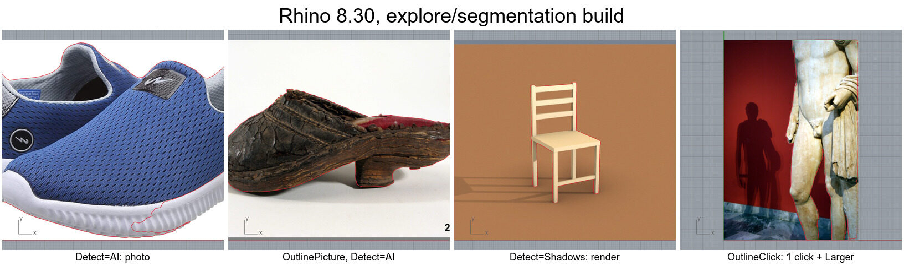
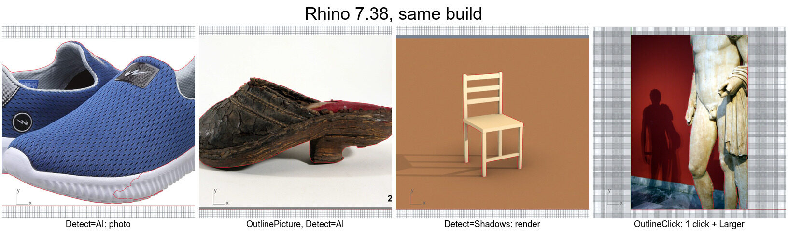
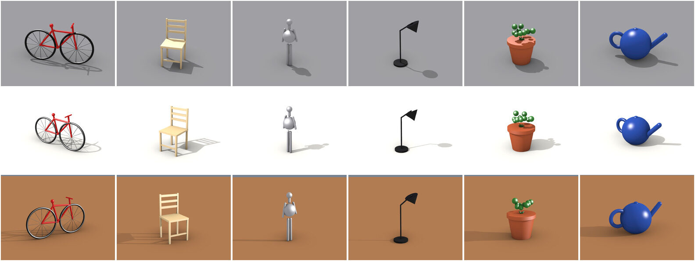
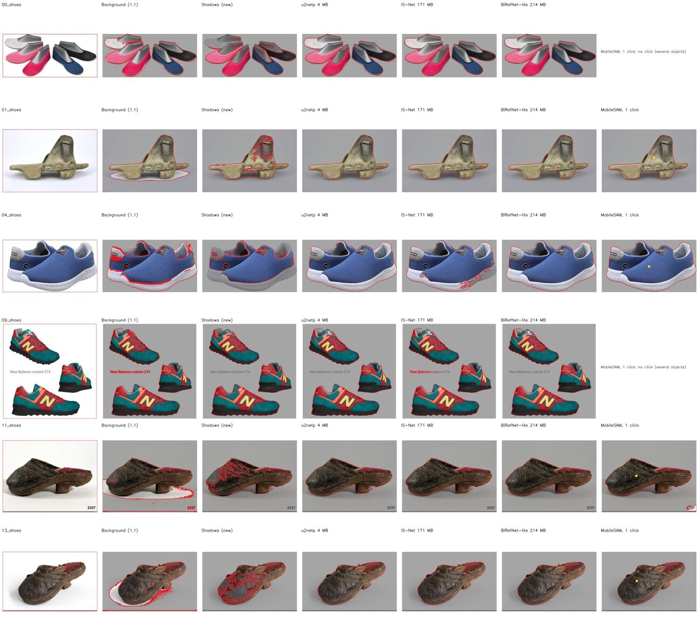
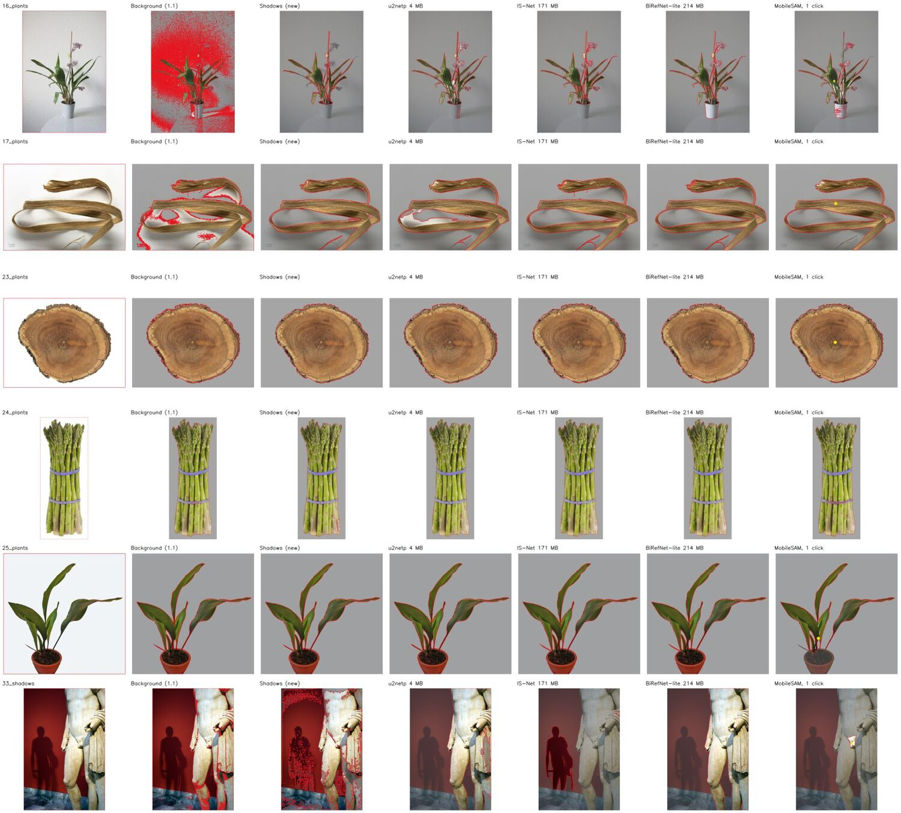

# Background removal and segmentation for Rhino Outline

Branch `explore/segmentation`, experimental, not released.

Rhino Outline 1.1 finds the shape by transparency, by the border colour or by dark pixels.
That works for clip art, scans and product shots on a clean backdrop. It fails on photos:
a cast shadow differs from the backdrop, so it is traced as part of the object, and a room or
a wall behind the object is traced too. This study compares classical background removal with
small neural networks, including small Segment Anything (SAM) models, on images with shadows,
and adds the useful ones to the plug-in.

## Result

| | What it is | Download | Time per image (CPU) | Use it for |
|---|---|---|---|---|
| `Detect=Shadows` | Classical: background subtraction that ignores cast shadows | none | 0.5 to 1.5 s | Objects on a plain or two-tone backdrop, with shadows |
| `Detect=AI`, `AIModel=Accurate` | IS-Net (DIS) salient object network | 171 MB once | about 2 s | Photos in general |
| `Detect=AI`, `AIModel=Best` | BiRefNet lite | 214 MB once | 15 to 30 s | When `Accurate` picks the wrong thing |
| `Detect=AI`, `AIModel=Fast` | U²-Net small (u2netp) | 4.4 MB once | 0.3 s | Quick tries, simple photos |
| `OutlineClick` | MobileSAM (small Segment Anything): click on the object | 43 MB once | about 1 s per click | Cluttered photos, several objects, when you want a specific one |

The networks are downloaded the first time they are used, after the plug-in asks, into
`%LOCALAPPDATA%\RhinoOutline\models`, and are checked against their SHA-256. They are not part
of the plug-in. ONNX Runtime (12.5 MB, MIT licence) is shipped next to the `.rhp`.

Tested in Rhino 8.30 and Rhino 7.38 (same build): `Detect=AI` with `Outline` and
`OutlinePicture`, `Detect=Shadows`, and `OutlineClick` with `Larger`, all give closed, valid
outlines, identical in both versions ([`rhino_test.py`](rhino_test.py)).

## How the methods were compared

**Rendered scenes with exact ground truth** ([`make_scenes.cs`](make_scenes.cs), Rhino 8):
six objects (chair, potted plant, teapot, lamp, bicycle, standing figure) on a ground plane
with real cast shadows, under three setups. Studio: light floor and sun at 45°. Warm floor: a
brown floor below a blue-grey background, low sun and long hard shadows. Dim: grey floor, grey
figure, black lamp. That gives 18 images. The true mask is a second capture of the same view
without the ground plane, on a transparent background. Noise and JPEG compression are added
before testing so the renders behave like photos.

**12 real photos** from Wikimedia Commons (list below): shoes and museum objects with soft
shadows, a plant in a room, a statue in front of a red wall with a person's shadow on it,
several objects in one picture. These have no ground truth and are judged by eye. The click
methods use one point on the object, as a user would click.

Scores on the renders (higher is better, 1 is perfect). IoU is the overlap with the true
mask. *Holes filled* scores the outer silhouette only, which is what the outline follows (with
`Holes=No`). Boundary F is the share of the edge within 2 px of the true edge. The full table
is [`results.md`](results.md), per image [`results.csv`](results.csv).

| Method | Model MB | IoU | IoU, holes filled | Boundary F | Worst image | s per image |
|---|---|---|---|---|---|---|
| Border colour (`Detect=Background`, 1.1) | 0 | 0.581 | 0.656 | 0.538 | 0.431 | 0.08 |
| GrabCut (OpenCV), rectangle start | 0 | 0.278 | 0.360 | 0.309 | 0.026 | 3.0 |
| Shadow-aware, smooth background only | 0 | 0.580 | 0.596 | 0.664 | 0.052 | 0.3 |
| Background grown from the border (flood) | 0 | 0.539 | 0.532 | 0.501 | 0.000 | 0.1 |
| **Shadow-aware + border palette (`Detect=Shadows`)** | 0 | **0.822** | **0.837** | **0.818** | 0.052 | 1.5 |
| Shadow-aware + palette, then GrabCut | 0 | 0.841 | 0.875 | 0.864 | 0.052 | 2.1 |
| u2netp (`Fast`) | 4.4 | 0.728 | 0.850 | 0.820 | 0.337 | 0.3 |
| silueta | 43 | 0.749 | 0.884 | 0.829 | 0.666 | 1.0 |
| **IS-Net general (`Accurate`)** | 171 | **0.940** | **0.955** | **0.966** | 0.662 | 1.7 |
| **BiRefNet lite (`Best`)** | 214 | **0.960** | **0.976** | **0.975** | 0.740 | 15 |
| MobileSAM, box from `Shadows` | 43 | 0.814 | 0.927 | 0.929 | 0.356 | 2.3 |
| MobileSAM, box from u2netp | 47 | 0.808 | 0.921 | 0.924 | 0.685 | 1.5 |
| SAM 2.1 tiny, box from `Shadows` | 148 | 0.794 | 0.903 | 0.876 | 0.346 | 3.9 |
| MobileSAM, 1 click, network's best guess | 43 | 0.623 | 0.699 | 0.674 | 0.007 | 1.1 |
| **MobileSAM, 1 click, largest candidate inside the frame (`OutlineClick`)** | 43 | **0.846** | **0.957** | **0.921** | 0.765 | 1.2 |
| SAM 2.1 tiny, 1 click, same rule | 148 | 0.851 | 0.833 | 0.778 | 0.173 | 2.7 |

Timings are on an Intel i9-9880H (8 cores), ONNX Runtime on the CPU, median over all 30
images.

### Real photos

Red is the outline of the mask, the grey wash is what the method calls background, the yellow
dot is the click.

| Photo | Background (1.1) | Shadows | u2netp | IS-Net | BiRefNet lite | MobileSAM click |
|---|---|---|---|---|---|---|
| Several shoes on white, soft shadows | shadows in | loses the white shoe | ✓ | ✓ | ✓ | (one object per click) |
| Old shoe, shadow below | shadow in | ✓ outline, specks inside | ✓ | ✓ | ✓ | ✓ |
| Blue shoe, white sole on white | shadow in | loses the sole | ✓ | sole ragged | ✓ | ✓ |
| Three shoes and a text label | label in | ✓ | ✓ | label in | ✓ | (one object per click) |
| Museum shoes, dark leather, shadow | shadow in | ✓ outline, specks inside | ✓ | ✓ | ✓ | ✓ |
| Orchid in a room | wall in | plant, not the white pot | ✓ | ✓ | ✓ | ✓ |
| Raffia with shadows | shadows in | ✓ | part missing | ✓ | ✓ | ✓ |
| Wood slice, asparagus, potted plant | ✓ | ✓ | ✓ | ✓ | ✓ | ✓ (plant: `Larger` adds the pot) |
| Statue, red wall, person's shadow | wall in | wall in | ✓ (drapery ragged) | **the shadow** | ✓ | part, ✓ after `Larger` |

## What was learned

* **Shadows can be handled without a network** when the backdrop is plain. A cast shadow
  darkens the surface it falls on by about the same factor in R, G and B, so in linear RGB the
  ratio pixel / background is a grey below 1. The pixel's colour changes, but its chromaticity
  does not. `Detect=Shadows` uses that test against two background models:
  * a smooth estimate interpolated in from the image border, which follows gradients and
    vignetting;
  * each main border colour (k-means), so a floor seen below a wall is background wherever it
    appears.

  Pixels along the line where two background colours meet are a blend of the two, and are
  tested against that blend too. This raised the renders from 0.656 to 0.837, and
  every warm-floor scene from 0.08–0.35 to 0.85–0.99.
* **Its limit is ambiguity, not tuning.** A grey figure on a grey floor (0.05 to 0.11), white
  on white, and dark neutral leather (reads as shadow, so specks appear inside; the outer
  outline is still right) cannot be decided from colour. Pixel-to-pixel region growing (the
  flood variant) is worse, because it walks through gradual shading into dark objects.
* **Salient object networks solve most photos automatically.** IS-Net is the best trade-off
  (0.955, 2 s, 171 MB). BiRefNet lite is the most reliable (0.976, worst image 0.74) but takes
  15 to 30 s on a CPU. Both are trained to find "the main object". That is why IS-Net outlines
  the dark silhouette on the wall instead of the pale statue, and why several separate objects
  come out as one mask.
* **SAM needs a prompt, and the prompt matters more than the model.** With an automatic box it
  only matches the method that drew the box. With one click it is as good as IS-Net (0.957
  against 0.955). But for one click SAM returns several candidates (a part, the object, the
  object with its floor), and the candidate it rates best is often only a part (0.699).
  `OutlineClick` takes the largest candidate that does not run into the image border more than
  the tightest one does (0.957). When the object itself is cut off by the frame, like the
  statue, `Larger` and `Smaller` step through the other candidates.
* **SAM 2.1 tiny was no better than MobileSAM** here (0.833 against 0.957 with a click, 148 MB
  against 43 MB): its candidates for thin objects (the bicycle) are parts.
* GrabCut on its own needs a good start; seeded with the `Shadows` mask it adds a little
  (0.837 to 0.875) at the cost of a second, OpenCV dependency. It was not added.

## In the plug-in

* `-Outline`: `Detect=Shadows` and `Detect=AI`. With `Detect=AI` the option `AIModel`
  (`Fast`, `Accurate`, `Best`) appears. `Threshold` still works: it cuts the network's
  probability. `Outline` and `OutlinePicture` use the remembered setting.
* `OutlineClick`: select a picture (one placed with `Picture`, cropped or not), click on the
  object, and the outline follows. Click again to add more of the object, `Undo` removes the
  last click, `Larger` and `Smaller` switch between the objects the network sees under one
  click. Enter keeps the outline.
* Code: [`ShadowMask.cs`](../../src/RhinoOutline.Core/ShadowMask.cs) (no dependencies),
  [`Segmentation/`](../../src/RhinoOutline/Segmentation) (ONNX Runtime, model download),
  [`OutlineClickCommand.cs`](../../src/RhinoOutline/OutlineClickCommand.cs). The C# `Shadows`
  mask matches the Python prototype (mean IoU 0.997 between the two).

Open points before a release:

* The `.rhi` grows from 40 KB to 4.5 MB (ONNX Runtime). Rhino on macOS would need the
  macOS runtime and is untested.
* The model download needs internet access on first use; schools behind a proxy may need the
  files copied into `%LOCALAPPDATA%\RhinoOutline\models` by hand.
* `Best` blocks Rhino for 15 to 30 s with no progress bar.

## Licences

The plug-in stays GPL v2. ONNX Runtime is MIT. The networks are downloaded separately, not
distributed with the plug-in:

| Model | Source | Licence |
|---|---|---|
| u2netp, silueta | [U²-Net](https://github.com/xuebinqin/U-2-Net), ONNX from [rembg](https://github.com/danielgatis/rembg) | Apache 2.0 |
| IS-Net general use | [DIS](https://github.com/xuebinqin/DIS), ONNX from rembg | Apache 2.0 |
| BiRefNet lite | [BiRefNet](https://github.com/ZhengPeng7/BiRefNet), ONNX from rembg | MIT |
| MobileSAM | [MobileSAM](https://github.com/ChaoningZhang/MobileSAM), ONNX from [Acly/MobileSAM](https://huggingface.co/Acly/MobileSAM) | Apache 2.0, ONNX export MIT |
| SAM 2.1 tiny (tested, not used) | [SAM 2](https://github.com/facebookresearch/sam2), ONNX from [onnx-community](https://huggingface.co/onnx-community/sam2.1-hiera-tiny-ONNX) | Apache 2.0 |

BRIA RMBG 1.4 and 2.0 were not tested: their licence does not allow commercial use.

The photo comparison figures (`docs/segmentation/photos-*.jpg`) show these Wikimedia Commons
photos, with overlays, and are shared under the same licences:

| File | Photo | Author | Licence |
|---|---|---|---|
| 00_shoes | [070 Basic weiss, schwarz, rosa, pink, dunkelblau](https://commons.wikimedia.org/wiki/File:070_Basic_weiss,_schwarz,_rosa,_pink,_dunkelblau.jpg) | Roben123 | CC BY-SA 3.0 |
| 01_shoes | [Trip, hout-leer-ijzer (1400-1500)](https://commons.wikimedia.org/wiki/File:2003_(2013-02-27)_Trip,_hout-leer-ijzer_(1400-1500).jpg) | Archeologie Gorinchem | CC BY-SA 2.0 |
| 04_shoes | [Campus BlueWhite](https://commons.wikimedia.org/wiki/File:Campus_BlueWhite.jpg) | dfgfdd | CC BY-SA 4.0 |
| 09_shoes | [New Balance custom 574](https://commons.wikimedia.org/wiki/File:New_Balance_custom_574.jpg) | Petar Milošević | CC BY-SA 3.0 |
| 11_shoes | [Sko - Nordiska museet - NM.0002337 (1)](https://commons.wikimedia.org/wiki/File:Sko_-_Nordiska_museet_-_NM.0002337_(1).jpg) | Elisabeth Eriksson | CC BY 4.0 |
| 13_shoes | [Sko - Nordiska museet - NM.0002337 (3)](https://commons.wikimedia.org/wiki/File:Sko_-_Nordiska_museet_-_NM.0002337_(3).jpg) | Elisabeth Eriksson | CC BY 4.0 |
| 16_plants | [Acacallis cyanea x Otostylis brachystalix 'Rhein Blue Baby'](https://commons.wikimedia.org/wiki/File:Acacallis_cyanea_x_Otostylis_brachystalix_%27Rhein_Blue_Baby%27_(8295351844).jpg) | Maja Dumat | CC BY 2.0 |
| 17_plants | [Adansonia digitata MHNT.BOT.2020.2.2](https://commons.wikimedia.org/wiki/File:Adansonia_digitata_MHNT.BOT.2020.2.2.jpg) | Roger Culos | CC BY-SA 4.0 |
| 23_plants | [Arbutus unedo coupe MHNT](https://commons.wikimedia.org/wiki/File:Arbutus_unedo_coupe_MHNT.jpg) | Roger Culos | CC BY-SA 4.0 |
| 24_plants | [Asparagus-Bundle](https://commons.wikimedia.org/wiki/File:Asparagus-Bundle.jpg) | Evan-Amos | CC BY-SA 3.0 |
| 25_plants | [Aspidistra 01 (fcm)](https://commons.wikimedia.org/wiki/File:Aspidistra_01_(fcm).jpg) | Frank C. Müller | CC BY-SA 2.0 de |
| 33_shadows | [Archaeological Museum, Athens - Hermes](https://commons.wikimedia.org/wiki/File:0622_-_Archaeological_Museum,_Athens_-_Hermes_-_Photo_by_Giovanni_Dall%27Orto,_Nov_10_2009.jpg) | Giovanni Dall'Orto | Attribution |

## Reproduce

Needs Python 3.10+ with `numpy`, `opencv-python` and `onnxruntime`, and Rhino 8 for the
renders.

1. Run [`make_scenes.cs`](make_scenes.cs) in the Rhino 8 ScriptEditor (writes `data\render`).
2. Download the photos above (1200 px wide) into `data\photos` with the file names in the
   table, and copy [`photos.json`](photos.json) there (click points and attribution).
3. Download the models (URLs in [`methods.py`](methods.py) and
   [`NeuralModels.cs`](../../src/RhinoOutline/Segmentation/NeuralModels.cs)) into one folder.
4. `set SEG_DATA=...\data`, `set SEG_MODELS=...\models`, `set SEG_OUT=...\out`, then
   `python bench.py`. It writes `results.csv`, `summary.md`, one overlay sheet per image and
   every mask.
5. In Rhino 7 or 8, after building with `build.ps1 -Dist dist-seg`:
   `_-RunPythonScript research\segmentation\rhino_test.py` (adjust the paths at the top).
